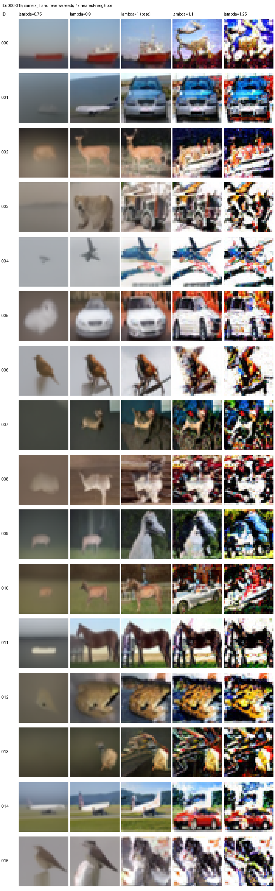

# Khảo sát cấu trúc quanh λ=1 — 128 ảnh mỗi mức

Mục tiêu: quan sát vùng λ còn giữ được cấu trúc ảnh và vùng bắt đầu suy giảm.
Bốn mức mới là **0,75; 0,9; 1,1; 1,25**, mỗi mức đúng **128 ảnh**; baseline
λ=1 dùng lại 128 ảnh đã có. Tổng cộng sinh thêm 512 ảnh thí nghiệm, không train lại,
không sinh bộ 5.000 ảnh và không tính FID/IS cho lần khảo sát này.

## Mở ảnh để so sánh

Mỗi hàng trong trang ghép là **cùng một sample ID**, cùng x_T và reverse seeds.
Thứ tự cột cố định: **λ=0,75 → 0,9 → 1 → 1,1 → 1,25**. Baseline ở cột giữa.
Toàn bộ 128 ID đầu tiên được giữ nguyên thứ tự, không chọn ảnh theo độ đẹp.

| Sample IDs | Trang ghép năm mức |
|---|---|
| 000–015 | [Mở trang 1](figures/paired_000_015.png) |
| 016–031 | [Mở trang 2](figures/paired_016_031.png) |
| 032–047 | [Mở trang 3](figures/paired_032_047.png) |
| 048–063 | [Mở trang 4](figures/paired_048_063.png) |
| 064–079 | [Mở trang 5](figures/paired_064_079.png) |
| 080–095 | [Mở trang 6](figures/paired_080_095.png) |
| 096–111 | [Mở trang 7](figures/paired_096_111.png) |
| 112–127 | [Mở trang 8](figures/paired_112_127.png) |

Grid đủ 128 ảnh theo từng mức:
[λ=0,75](figures/lambda_0.75_128.png),
[λ=0,9](figures/lambda_0.9_128.png),
[λ=1, baseline](figures/lambda_1_128.png),
[λ=1,1](figures/lambda_1.1_128.png),
[λ=1,25](figures/lambda_1.25_128.png).

Ảnh gốc có kích thước 32×32; trang ghép phóng 4 lần, grid riêng phóng 3 lần
bằng nearest-neighbor, không nội suy làm mịn. Chuyển sang PNG dùng cùng phép
làm tròn về uint8 cho cả năm mức.

## Nhận xét trực quan và vùng chuyển tiếp

| Mức λ | Quan sát trên bộ 128 ảnh |
|---:|---|
| 0,75 | Nhiều ảnh chỉ còn bóng vật thể hoặc mảng màu; biên mềm, thiếu bộ phận và nền. Một số mẫu vẫn nhận ra hình dạng, nên không phải mọi ảnh đều mất cấu trúc. |
| 0,9 | Nhiều vật thể đã nhận ra rõ hơn 0,75, nhưng ảnh vẫn mờ, nền đơn giản và mất chi tiết so với baseline. Đây đã là dấu hiệu suy giảm, chưa tương đương chất lượng λ=1. |
| 1 | Cân bằng cấu trúc, chi tiết và độ tự nhiên tốt nhất về quan sát trong năm mức này; vẫn có mẫu méo hoặc khó nhận dạng. |
| 1,1 | Nhiều hình dạng lớn còn nhận ra, nhưng texture dày, tương phản/màu gắt và nền rối xuất hiện rõ; có mẫu đổi nội dung hoặc mất liên kết giữa các bộ phận. |
| 1,25 | Các dấu hiệu trên mạnh hơn: mảng sáng/tối bị đẩy gắt, biên phân mảnh và texture lấn át cấu trúc. Một số xe, ngựa hoặc máy bay vẫn nhận ra. |

**Ở phía giảm λ**, hai mức 0,9 và 1 còn giữ nhiều hình dạng vật thể; tại 0,9
đã thấy mất chi tiết, còn 0,75 cho thấy suy giảm cấu trúc mạnh trên nhiều mẫu.
Các điểm đo này gợi ý khảo sát khoảng **(0,9; 1)** nếu cần định vị lúc bắt đầu mất
chi tiết, và **(0,75; 0,9)** nếu cần định vị chuyển tiếp sang mất cấu trúc nặng.
**Ở phía tăng λ**, suy giảm độ tự nhiên/texture đã rõ ở 1,1, nên khoảng
**(1; 1,1)** là khoảng cần phân giải thêm; 1,25 cho thấy suy giảm nặng hơn.
Đây là các khoảng gợi ý từ những mức rời rạc, chưa xác nhận mọi λ bên trong có
cùng chất lượng hoặc một ngưỡng chung cho mọi ảnh.

Một số ID dễ đối chiếu, ngoài việc xem toàn bộ mẫu:

- **000, 004, 005, 006, 011** ([trang 1](figures/paired_000_015.png)):
  lần lượt có tàu, máy bay, ô tô, chim và ngựa ở baseline; nhìn rõ xu hướng từ
  bóng mờ ở 0,75 sang hình dạng rõ hơn ở 0,9/1, rồi texture/màu gắt ở 1,1/1,25.
- **001, 003** trên trang 1 cho thấy nội dung cũng có thể đổi khi thay λ;
  không nên xem đây là phép làm mờ một ảnh baseline cố định.
- **117, 120, 122, 124, 127** ([trang 8](figures/paired_112_127.png)):
  đối chiếu thêm tàu, ngựa và xe ở các ID cuối, tránh chỉ dựa vào trang đầu.
  ID120 vẫn giữ dáng ngựa ở 0,75, minh họa mức độ nhạy khác nhau giữa các mẫu.

## Điều kiện đối chiếu

- EMA checkpoint 200.000 updates; T=1000, linear beta 1e-4 → 0,02,
  epsilon prediction, fixedlarge, cùng model và công thức mean.
- GPU Modal: một NVIDIA L40S; batch64; float32; deterministic; TF32 tắt;
  PyTorch 2.7.1+cu128 / CUDA 12.8.
- Đọc đúng hai tensor x_T đầu tiên của bank evaluation cũ, sample IDs 000–127.
  Init seed=1002026 và reverse seed=20001; mỗi batch cộng batch_index.
- Mỗi nhánh λ>0 reset generator theo cùng seed nên dùng cùng dòng z_t.
  λ nhân **độ lệch chuẩn**, không nhân phương sai.
- Replay baseline trên một full batch64 trước khi chạy; max absolute difference
  so với baseline đã lưu bằng **0**. 128 ảnh baseline hiển thị được sao chép từ
  kết quả cũ; batch replay chỉ dùng xác nhận và warm-up.
- ID ở đây thuộc bank **evaluation**, khác bank preview64 trong báo cáo chính.
  Khi so với λ=0,5/0,1/0, phải dùng cùng ID của bank evaluation, không ghép với preview64.

| λ | Phương sai tương đối λ² | N | Nguồn |
|---:|---:|---:|---|
| 0,75 | 0,5625 | 128 | Chạy bổ sung |
| 0,9 | 0,81 | 128 | Chạy bổ sung |
| 1 | 1 | 128 | Tái dùng baseline |
| 1,1 | 1,21 | 128 | Chạy bổ sung |
| 1,25 | 1,5625 | 128 | Chạy bổ sung |

## Dữ liệu và kiểm chứng

Gói local `reproducibility.zip` chứa 640 PNG gốc (512 ảnh mới và
128 baseline), tensor float32, hai batch x_T, protocol, manifests, baseline replay,
log chi phí, kiểm chứng tải xuống và ba file nguồn sampling. Không lưu code Modal.
Các PNG riêng nằm trong `png/lambda_*/000.png` đến `127.png` bên trong ZIP.
ZIP được loại khỏi Git; bản GitHub có đầy đủ grid/trang ghép của 128 ID ở trên.

Đã kiểm tra CRC của ZIP; SHA256, ID và input hash của từng chunk;
shape/dtype/range/finiteness; mọi PNG khớp tensor sau phép làm tròn.
Hai batch x_T và hai batch baseline khớp byte với gói thí nghiệm cũ.
Suite CPU: **9/9 pass**, gồm lưu/replay/resume cho các mức λ mới.
Metadata JSON được gom trong ZIP, không rải thành file riêng ở thư mục báo cáo.

Lượt bổ sung dùng khoảng **359,75 giây GPU** (gồm load, replay/warm-up và I/O);
sampling bốn mức mất khoảng 77,1–77,4 giây/mức. Chi phí compute bổ sung ước tính
bảo thủ **0,246 USD**; tích lũy toàn ablation **9,504 USD / 20 USD**.
Đây là ước tính ứng dụng có dự phòng, không phải hóa đơn Modal. Chi tiết nằm
trong `cost_cumulative.json` của ZIP. Container GPU đã dừng sau khi hoàn tất.

Đây là khảo sát trực quan trên 128 mẫu cố định, chưa xác định ngưỡng chính xác
hoặc chứng minh chất lượng phân phối. Cùng x_T và z_t giúp đối chiếu nhưng thay λ
có thể đổi cả nội dung ảnh; không mặc định vật thể phải giữ cùng lớp giữa các cột.
Không đưa các mức N=128 vào bảng FID/IS N=5.000 của
[báo cáo chính](../report_vi.md).
