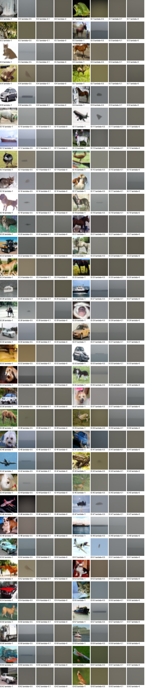

# Ablation: nhiễu trong DDPM reverse sampling

Ngày thực hiện: 20/10/2026 (Asia/Saigon).

Bản GitHub gồm báo cáo, CSV và ảnh so sánh. Các gói `reproducibility.zip`
chỉ lưu local, không được upload; các đường dẫn metadata trong ZIP ở dưới dùng
để tra cứu khi có gói local.

## Câu hỏi và kết quả

Trên checkpoint EMA 200.000 updates, cùng T=1000 và N=5,000 ảnh mỗi điều kiện,
bỏ nhiễu reverse làm FID thay đổi từ 8.6341 sang
479.6542. **delta_FID = +471.0200**
(FID_mean_only − FID_baseline; dương nghĩa mean-only kém hơn).

Đây là phép so sánh trong cùng protocol, không phải tái lập điểm paper.

Sau khi bổ sung λ=0,5 và λ=0,1, trong bốn mức đã đo, FID tăng khi giảm λ theo
thứ tự 1 → 0,5 → 0,1 → 0; IS đồng thời giảm. Baseline λ=1 có kết quả tốt nhất
trong bộ điều kiện này. Các mức bổ sung nằm giữa baseline và mean-only về metric,
nhưng grid vẫn cho thấy suy giảm mạnh cấu trúc vật thể so với baseline.

## Chỉ một yếu tố thay đổi

- Cùng checkpoint EMA, kiến trúc ch128, ch_mult=[1,2,2,2], attention=[1], hai residual blocks.
- Cùng linear beta 1e-4 → .02, epsilon prediction, fixedlarge, clipping x0 và đầu ra.
- Cùng float32, eval/inference_mode, deterministic, TF32 tắt, GPU NVIDIA L40S, batch64.
- Cùng tensor x_T và sample ID; bank preview độc lập bank đánh giá.
- Chỉ thay hệ số độ lệch chuẩn λ trong mean + λ·sigma·z. λ=0 không phải DDIM eta=0.
- Không train lại, không giảm timestep; mỗi ảnh vẫn gọi U-Net 1.000 lần.

Checkpoint SHA256: `0c8fe72c7fb3d53aa0b194a5663d9bc6e7992619ca1275c2dbdaf55b9099bb76`.
Nguồn gốc repo: `f38fbe8ae1a465578b438ecdc3d058aa383981b7`; hash mã thực thi có trong metadata.
Torch/CUDA: 2.7.1+cu128 / 12.8.
Evaluation seeds: init=1002026, reverse=20001; mỗi batch cộng batch_index vào seed.

## So sánh ảnh theo cặp

Mỗi nhóm bốn ô cùng sample ID và x_T; thứ tự trái sang phải là λ=1, 0,5, 0,1 và 0. Giữ nguyên thứ tự 64 mẫu preview, không chọn theo độ đẹp.

Grid riêng: [λ=0,5](figures/lambda_0.5_64.png), [λ=0,1](figures/lambda_0.1_64.png). [Grid hai điều kiện ban đầu](figures/paired_64.png) vẫn được giữ để tham chiếu.

## Metric cùng protocol

| Điều kiện | λ | N | FID ↓ | IS ↑ | IS std (10 splits) | Giây/ảnh |
|---|---:|---:|---:|---:|---:|---:|
| DDPM baseline | 1 | 5.000 | 8.6341 | 8.5895 | 0.5260 | 0.6138 |
| DDPM λ=0.5 | 0.5 | 5.000 | 365.5376 | 1.4542 | 0.0216 | 0.6245 |
| DDPM λ=0.1 | 0.1 | 5.000 | 468.8843 | 1.0790 | 0.0041 | 0.6259 |
| DDPM mean-only | 0 | 5.000 | 479.6542 | 1.0379 | 0.0042 | 0.6142 |

## Khảo sát vùng chuyển tiếp quanh λ=1 (N=128)

Đã chạy thêm **λ=0,75; 0,9; 1,1; 1,25, mỗi mức 128 ảnh** trên một GPU Modal
L40S; tái dùng 128 ảnh baseline. Không sinh thêm bộ 5.000 ảnh, không tính FID/IS.
Mỗi mức dùng hai batch x_T đầu của bank evaluation cũ, cùng reverse seeds,
EMA, T=1000 và float32. Replay full batch64 baseline khớp tuyệt đối (max diff=0).

Mở [báo cáo trực quan và toàn bộ 128 mẫu](qualitative_128/README.md), hoặc
[trang so sánh đầu tiên](qualitative_128/figures/paired_000_015.png).
Mỗi hàng có cùng ID, thứ tự cột: **0,75 → 0,9 → 1 → 1,1 → 1,25**.
ID thuộc bank evaluation, không phải bank preview64 ở trên.

Quan sát bộ ảnh: λ=0,9 còn giữ nhiều hình dạng nhưng đã mờ và mất chi tiết;
λ=0,75 làm nhiều ảnh chỉ còn bóng/mảng màu. Phía tăng λ, tại 1,1 đã xuất hiện
texture dày, tương phản gắt và nền rối; tại 1,25 các dấu hiệu này nặng hơn,
biên/bộ phận bị phân mảnh dù một số vật thể vẫn nhận ra. λ=1 cho cân bằng tốt
nhất về quan sát trong năm mức này.

Các điểm đo gợi ý vùng **(0,9; 1)** để tìm dấu hiệu mất chi tiết ban đầu,
**(0,75; 0,9)** để tìm chuyển tiếp sang mất cấu trúc nặng, và **(1; 1,1)**
để tìm lúc texture bắt đầu suy giảm khi tăng nhiễu. Chưa nội suy ngưỡng chính xác
hoặc khẳng định mọi giá trị trong một khoảng đều giữ chất lượng.
Phần bổ sung lưu đủ ảnh gốc và metadata trong một ZIP, không thêm JSON rời.

## Bổ sung λ=0,5 và λ=0,1

Hai điều kiện được bổ sung theo yêu cầu sau thí nghiệm λ=1/0, với N=5.000 mỗi
điều kiện được cố định trước khi sinh ảnh mới. Không train lại hoặc sinh lại bộ
5.000 ảnh baseline/mean-only. Hai nhánh mới đọc đúng bank x_T preview và evaluation
đã lưu, cùng batch64, T=1000, float32, checkpoint EMA và reverse seeds cũ.
Đối với λ>0, reset cùng generator seed theo batch nên các nhánh dùng chung dòng z_t.

Để nối hai lần chạy, replay baseline trên cùng batch64 và reverse seed ở cả hai
GPU L40S; sai khác tối đa so với ảnh baseline đã lưu đều bằng 0. Các hash của
reference, Inception weights, score implementation và protocol metric đều khớp.

| Điều kiện bổ sung | delta_FID so với λ=1 |
|---|---:|
| λ=0,5 | +356.9034 |
| λ=0,1 | +460.2501 |

λ nhân độ lệch chuẩn: λ=0,5 tương ứng 25% phương sai baseline, λ=0,1 tương ứng 1%.
Đây là bốn mức λ rời rạc trên một checkpoint; chưa đủ để suy ra đường cong liên tục,
mức λ tối ưu hoặc quy luật cho mọi DDPM.

Trong grid preview, λ=0,5 có các vùng sáng tối, đường phân chia nền và một số
vệt hoặc bóng mờ; phần lớn vẫn thiếu cấu trúc vật thể nhận diện được. λ=0,1 chủ
yếu là mảng màu gần phẳng và gradient nhẹ, gần nhánh λ=0 hơn về quan sát trực quan.
Ở cả hai mức này, các chi tiết/ngữ nghĩa thấy ở baseline λ=1 không được giữ tốt
trong bộ preview đã cố định. Đây là mô tả trên 64 mẫu, không phải phép đo độ phủ mode.
Độ lệch chuẩn không gian trung bình theo kênh là
0.03144 (λ=0,5) và
0.01367 (λ=0,1);
chỉ số pixel này chỉ mô tả mức biến thiên không gian, không thay thế FID/IS.

## Nhận xét

Trong preview đã cố định từ trước, baseline tạo được nhiều ảnh có cấu trúc nhận ra
như xe, máy bay, tàu, ngựa, chó và ếch; một số ảnh vẫn méo cấu trúc hoặc thiếu chi tiết.
Mean-only chủ yếu là mảng màu xám/nâu gần phẳng, mất biên và hình dạng vật thể.
Màu/độ sáng vẫn khác giữa các x_T; không nên diễn giải các ảnh này là giống nhau hoàn toàn.
Độ đồng đều trong nhánh mean-only không mang lại cải thiện nhận dạng vật thể trong grid này.
Độ lệch chuẩn không gian trung bình theo kênh trong 64 ảnh preview là
0.20898 (baseline) và
0.01365 (mean-only). Đây chỉ là mô tả pixel,
không phải metric về độ phủ mode; cả hai nhánh vẫn có 64 tensor ảnh khác nhau.

Các grid [baseline](figures/baseline_64.png) và
[mean-only](figures/mean_only_64.png) giữ nguyên ID, không chọn ảnh theo độ đẹp.

Thử 4 x_T × 4 reverse seeds:
[baseline](figures/baseline_reverse_seeds.png),
[mean-only](figures/mean_only_reverse_seeds.png).
Mỗi hàng dùng một x_T. Mean-only lặp theo reverse seed là hệ quả được thiết kế;
điều đó riêng lẻ không chứng minh mode collapse trên toàn phân phối.

## Kiểm tra tính đúng và chi phí

Sanity với U-Net thật, 2 ảnh và đủ T=1000:

| Kiểm tra | Max abs difference | Kết quả |
|---|---:|---|
| Vòng lặp gốc vs λ=1, cùng RNG | 0 | Pass |
| λ=0, đổi reverse seed | 0 | Pass |
| λ=1, cùng seed replay | 0 | Pass |
| λ=1, đổi reverse seed | 1.9218233 | Khác nhau như dự kiến |

Tất cả đầu ra hữu hạn, đúng shape và range. CPU tests ở lần đầu: 14/14 pass
(gồm test ngân sách Modal sau đó đã xóa); suite local hiện tại: 9/9 pass.
Smoke test training/CLI cũ với mô hình nhỏ và FakeData cũng pass ở lần đầu.
Hash/ID/shape/range của toàn bộ 10.000 ảnh ban đầu và 10.000 ảnh bổ sung đã được
kiểm tra sau tải xuống. Resume trên artifacts thật không gọi sampler và giữ
nguyên nội dung manifest (cho phép chuẩn hóa xuống dòng theo hệ điều hành).
Chi tiết kiểm chứng nằm trong `artifact_verification.json` và
`extension_05_01/artifact_verification.json` của gói dữ liệu tái lập local.

Chi phí compute bảo thủ tích lũy ước tính: **9,504 USD**,
so với ngân sách tối đa 20 USD. Đây là ước tính ứng dụng có dự phòng, không phải hóa đơn.
Chi phí lần đầu khoảng 4,811 USD; chi phí compute bổ sung ước tính 4,447 USD.
Lượt khảo sát bốn mức N=128 tốn thêm khoảng **0,246 USD** (359,75 giây GPU).
Chi tiết trước lượt khảo sát nằm trong `extension_05_01/cost_cumulative.json` của
gói dữ liệu tái lập local; ledger mới nhất nằm trong
`cost_cumulative.json` của gói local `qualitative_128/reproducibility.zip`.
Đối chiếu Modal để xem phí thực tế; container GPU của lượt bổ sung đã dừng.
Thời gian/ảnh trong bảng chỉ đo sampling, có CUDA synchronize, loại model load,
warm-up và I/O. Warm-up preview được báo riêng trong `preview/preview/timing.json`
của gói dữ liệu tái lập.
Giây/ảnh là throughput trên số ảnh thực sự sinh, kể cả padding; metric dùng đúng N.

## Metric và giới hạn

FID/IS đọc đúng N tensor float32 [0,1] mỗi nhánh, cùng score/both.py,
Inception weights và reference CIFAR10 train. Không dùng PNG grid/JPEG làm đầu vào metric.
Reference được tính lại từ toàn bộ 50.000 ảnh CIFAR10 train bằng đúng pipeline
Inception của repo; **không tuyên bố dùng file thống kê upstream được phân phối**.
Reference SHA256: `ccd676bc99d7b47587eef4bf0609982f7b42779b9983e6f2be112d6d7bc6351f`.
Metadata metric và nguồn reference nằm trong `evaluation/metrics_metadata.json`
và `evaluation/reference_provenance.json` của gói dữ liệu tái lập local.

- Một evaluation seed bank; chưa đo biến thiên qua các lần chạy độc lập.
- IS std là độ lệch chuẩn qua 10 splits, không phải sai số qua seeds hoặc confidence interval.
- FID/IS không tự tách riêng fidelity và diversity; grid không đo độ phủ mode.
- Không so trực tiếp FID ở N=5,000 với FID-50k của paper.
- Đã đo FID/IS ở λ=1; 0,5; 0,1; 0 với N=5.000; thêm khảo sát trực quan
  λ=0,75; 0,9; 1,1; 1,25 với N=128. Chưa đo các cửa sổ timestep;
  không khái quát cho mọi checkpoint/DDPM hoặc trộn hai cỡ mẫu vào cùng bảng metric.
- Sau khi thay λ, trajectory x_t thay đổi; giữ mean nghĩa giữ công thức/trọng số,
  không có nghĩa hai nhánh dùng cùng tensor mean ở mọi bước.
- Batch cuối được padding để giữ layout; metric dùng đúng 5,000 sample IDs đầu.
- Hai nhánh đánh giá chạy trên hai GPU cùng model L40S; cross_gpu_parity.json
  lưu kiểm tra cùng full batch và reverse seed giữa hai GPU trước khi chạy song song.

## Chạy lại

Hướng dẫn code/CLI: [ABLATION.md](../../../ABLATION.md).
Thư mục báo cáo đã được rút gọn:

- `report_vi.md`: báo cáo này.
- [metrics.csv](metrics.csv): bảng kết quả định lượng.
- `figures/`: tám ảnh minh họa, gồm grid so sánh bốn điều kiện và các grid ban đầu.
- `reproducibility.zip` (chỉ local, không upload): metadata JSON, log kiểm chứng,
  tensor ảnh, bank x_T và thống kê tham chiếu; không cần giải nén khi đọc báo cáo.
- [qualitative_128/](qualitative_128/README.md): khảo sát bốn mức quanh λ=1,
  13 grid/trang ghép có tham chiếu trong README; ZIP dữ liệu gốc chỉ lưu local.

Để tính lại metric hoặc resume, giải nén `reproducibility.zip` ngay trong thư mục
này. Gói giữ nguyên đường dẫn `evaluation/`, `preview/` và `sanity/` của lần đầu;
hai điều kiện mới nằm trong `extension_05_01/`. Mỗi bộ có protocol và manifests
riêng; metadata và ảnh gốc của lần đầu vẫn được giữ nguyên. Các manifest lưu hash,
sample IDs, reverse seeds và thời gian từng batch; không cần sampling lại khi tính metric.
